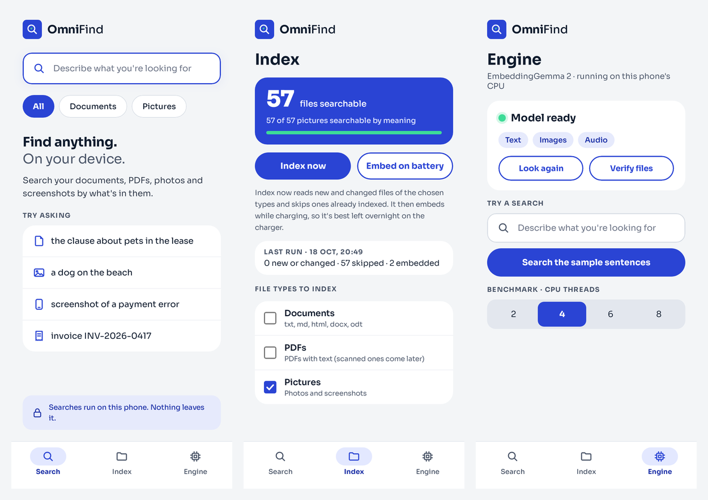

<h1 align="center">OmniFind</h1>

<b>Find anything. On your device.</b> 
Search the files on your Android phone by what's in them, with Google DeepMind's
<a href="https://huggingface.co/google/embeddinggemma-2">EmbeddingGemma 2</a>.

<a href="../../releases/latest"><b>Download OmniFind.apk (beta)</b></a> 
Free. Everything runs on your phone.

EmbeddingGemma 2 is the multimodal embedding model Google DeepMind released in October 2026. It puts text and images
into one shared space: a photo of a dog on a beach lands next to the words "a dog on the beach", and a screenshot of a
failed payment lands next to "payment declined error". It understands more than 100 languages, it's open (Apache 2.0),
and it's small enough to run on a phone's own processor, with no cloud and no graphics card.

OmniFind brings that to the files on your Android phone and its SD card. Pick the folders and the kinds of file to
search, and it reads the documents, PDFs, photos and screenshots in them. Then describe what you're looking for, in
your own words, and it finds the match, whatever kind of file it is.

## What you can find

- "the clause about pets in the lease" finds the page of the PDF and opens it there
- "a dog on the beach" finds the photo, and "screenshot of a payment error" the screenshot
- "notes from the trip to Goa" finds the note, even if it never uses those words
- a search in English can find a note written in Bengali, Arabic or any of the model's 100+ languages, and the other
  way around
- "invoice INV-2026-0417" finds the invoice by its exact number

Exact words count too. Invoice numbers, codes and names are matched as written, in file names, folder names and
document text, so a search gets both the meaning and the exact string. Every file is searchable by its words within
seconds of being read, before its meaning is in.

## Private

Nothing you index leaves your phone. OmniFind goes online only once, to download its model from Hugging Face (865 MB,
over Wi-Fi). It sends nothing about your files, ever. No account, no ads, no telemetry.

## Install

OmniFind is in beta. It needs a 64-bit Android phone (arm64) with Android 9 or later and about 1.5 GB free: 865 MB
for the model, plus room for the index.

1. Download **OmniFind.apk** from [Releases](../../releases/latest) on your phone, open it, and allow your browser or
   file manager to install apps when Android asks. (It isn't on Google Play yet.)
2. Open OmniFind, go to **Engine** and tap **Download the model**. It's 865 MB, downloaded once over Wi-Fi; a broken
   download picks up where it stopped, and each file is checked before it's used. Until it's in, search works by
   words only.
3. Go to **Index** and tap **Allow access to files**. On Android 9 and 10 that's the usual permission prompt; on
   Android 11 and later, Android asks you to turn on **All files access** for OmniFind in Settings, because that's
   the only way it lets an app read documents and PDFs. OmniFind only reads the folders you choose.
4. Choose the kinds of file (Documents, PDFs, Pictures) and the folders to search, on the phone and on the SD card,
   then tap **Index now**.

Your files are searchable by their words as soon as they're read. Search by meaning fills in as OmniFind embeds them,
which it does while the phone charges: leave it on the charger overnight for the first pass.

Already testing a beta? Install the new **OmniFind.apk** over it; your index and model are kept.

## Using it

OmniFind has three tabs:

| Tab | What it does |
|---|---|
| **Search** | Describe what you're looking for. Results come as you type: exact words at once, meaning a moment later. Filter by **All**, **Documents** or **Pictures** (pictures show as a grid). Strong matches come first; the rest are under "Weaker matches". |
| **Index** | How many files are searchable, and how far search by meaning has got. **Index now** reads new and changed files of the chosen types and skips the ones already indexed. **Embed on battery** embeds without waiting for the charger. Below: file types, folders, picture detail and background indexing. |
| **Engine** | Whether the model is on the phone, a download button if it isn't, a quick search over sample sentences, and a benchmark: tap a thread count (2, 4, 6 or 8) to time it on your phone. |

Tapping a result opens it: a PDF opens in OmniFind at the page that matched (with **Open in…** for your PDF app), a
picture in your gallery, and any other file in the app that handles it.

While OmniFind indexes, a notification shows how far it has got, with a **Stop** button. Stopping loses nothing; the
next run picks up where it left.

## What it reads

Only the folders you choose, and only the kinds of file you tick:

- **Documents**: txt, md, html, docx and odt, in pieces of about a page
- **PDFs**: page by page, up to 5,000 pages a file (scanned PDFs without a text layer come in a later beta)
- **Photos**: JPEG, PNG, WebP, HEIC and BMP, by what they show
- **Screenshots**: from your Screenshots folder, by what they show, with more detail than photos

It never reads keys, certificates or password files, hidden folders, the `Android` folder where apps keep their data,
caches, thumbnails or stickers. Pictures smaller than 256 pixels on their short side (icons, emoji) are skipped, and so
are documents over 20 MB and PDFs over 200 MB. OmniFind only reads your files; it never changes, moves or uploads
them.

Files on an SD card stay searchable while the card is out, and come back up to date when it's in again. A file
already indexed is only read again when it changes. Unticking a kind of file keeps the ones already indexed
searchable; unticking a folder removes its files from the index.

## How fast

The first pass is the slow part, and it happens once. OmniFind runs the model on the phone's processor, so on a
modest phone it takes its time. Measured on a Xiaomi Mi A1 (Snapdragon 625, 2017):

| | Time |
|---|---|
| A search | under half a second |
| A short note | about a second |
| A page of text | about 25 seconds |
| A photo | about 18 seconds (Standard detail) or 40 (Detailed) |
| A screenshot | about 40 seconds (Standard) or 100 (Detailed) |

So about 200 photos an hour, or 2,000 photos in two or three nights on the charger. The Index tab shows how many hours
are left. Faster phones are faster, and the Engine tab's benchmark shows whether more threads help on yours.

By default OmniFind embeds only while the phone charges and the battery isn't low, and it pauses when the battery
gets warm. After the first pass it only reads what's new or changed.

## FAQ

**How is this different from searching in the Files or Photos app?** They find files by their names, and some photo
apps by what's in the picture, but only for photos and usually in the cloud. OmniFind finds documents, PDFs, photos
and screenshots by what they say or show, in one search, entirely on the phone.

**Why is the download 865 MB?** That's the model: the text part (310 MB) and the image encoder (555 MB). The app
itself is 18 MB.

**Will it drain my battery?** Only the first pass is heavy, and by default it runs only while the phone charges. You
can turn that off in the Index tab, or tap **Embed on battery** to run it now.

**Which languages?** The model knows more than 100, and OmniFind searches in all of them, across languages too. Google
notes that the model isn't equally strong in every language. Exact-word matching doesn't split languages written
without spaces, like Chinese, Japanese and Thai, into words; search by meaning still works for them.

**Why does it need "All files access" on Android 11 and later?** From Android 11, the ordinary storage permission no
longer lets an app read documents and PDFs, only photos and media. OmniFind uses the access to read the folders you
choose, and nothing else.

**What doesn't it do yet?** Scanned PDFs, recordings and videos (the model can read sound, and DigUp already searches
them on a computer), and the text inside screenshots as exact words: screenshots are found by what they show.

**How do I remove it?** Uninstall it like any app. That also removes the model and the index, which live in
OmniFind's own folder. Your files are never touched.

## Release notes

### 0.3.0-beta.1

The first beta.

- Search documents (txt, md, html, docx, odt), PDFs, photos and screenshots by what's in them, in your own words and
  across languages, with exact words, numbers and names matched as written
- Choose the kinds of file and the folders to search, on the phone and on the SD card
- Files already indexed are skipped; nothing is read or embedded twice
- Indexing in the background while the phone charges, with progress and a Stop button
- PDFs open at the page that matched; pictures open in your gallery
- The model downloads inside the app, once, over Wi-Fi, checked before it's used
- Runs entirely on the phone's processor, from Android 9 on, tested on a 2017 Xiaomi Mi A1

**Thank you, Abdur Rahim.** OmniFind exists because of [DigUp](https://github.com/ARahim3/DigUp), Abdur Rahim's
open-source app that searches the files on your computer by what's in them with EmbeddingGemma 2. DigUp showed what
this model can do for everyday files, and its open code made OmniFind possible: the way OmniFind runs the model, ranks
meaning against exact words, and reads documents and pictures follows DigUp's, and its reference vectors are how we
checked that a phone finds the same things a computer does. If you have a Mac, a Windows PC or a Linux computer, try
DigUp, and consider [supporting its work](https://arahim3.gumroad.com/l/support).

## Thanks

OmniFind is inspired by [DigUp](https://github.com/ARahim3/DigUp) by Abdur Rahim (MIT), and runs
[EmbeddingGemma 2](https://huggingface.co/google/embeddinggemma-2) by Google DeepMind (Apache 2.0) through
[llama.cpp](https://github.com/ggml-org/llama.cpp) (MIT). It reads PDFs with
[PdfBox-Android](https://github.com/TomRoush/PdfBox-Android) (Apache 2.0), keeps its index in
[SQLite](https://sqlite.org) (public domain), shows pictures with [Coil](https://coil-kt.github.io/coil/) (Apache 2.0),
and is set in [Sora](https://github.com/sora-xor/sora-font) (SIL Open Font License). DigUp's and Sora's license
texts are in [third_party](third_party).

OmniFind isn't affiliated with Google, Xiaomi or the DigUp project. Gemma is a trademark of Google LLC; Android is a
trademark of Google LLC.

## License

MIT. See [LICENSE](LICENSE).

OmniFind solution design is adapted from DigUp, used under DigUp's MIT license; its notice is in
[third_party/DigUp-NOTICE.txt](third_party/DigUp-NOTICE.txt).
