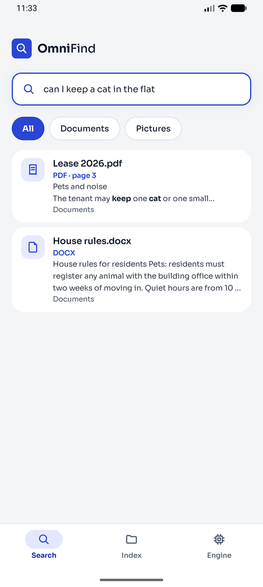
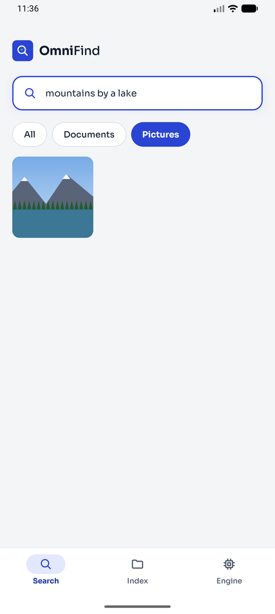
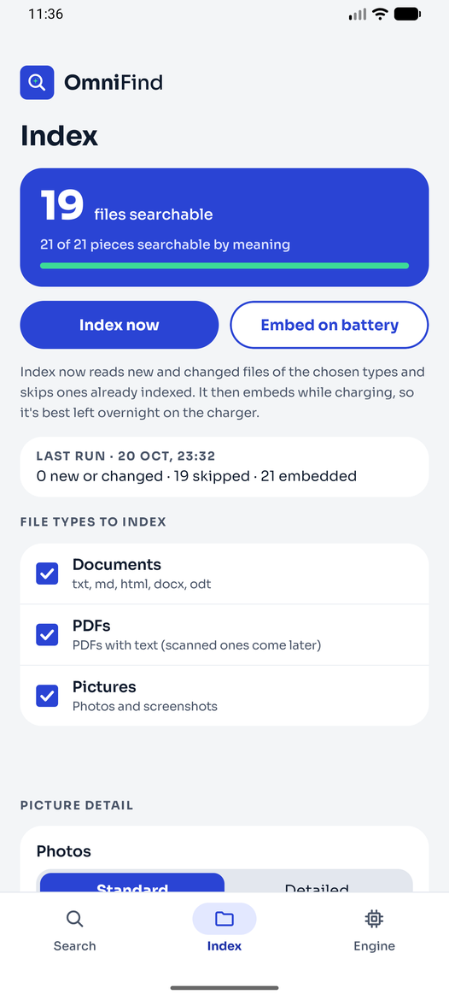
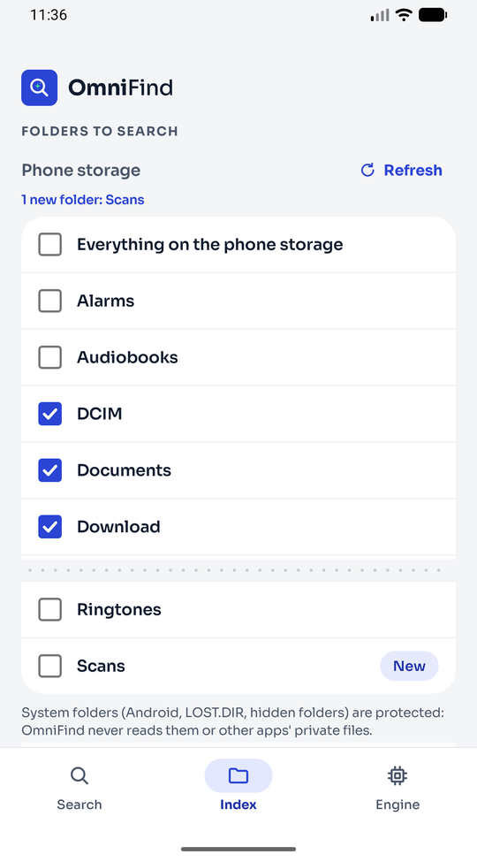
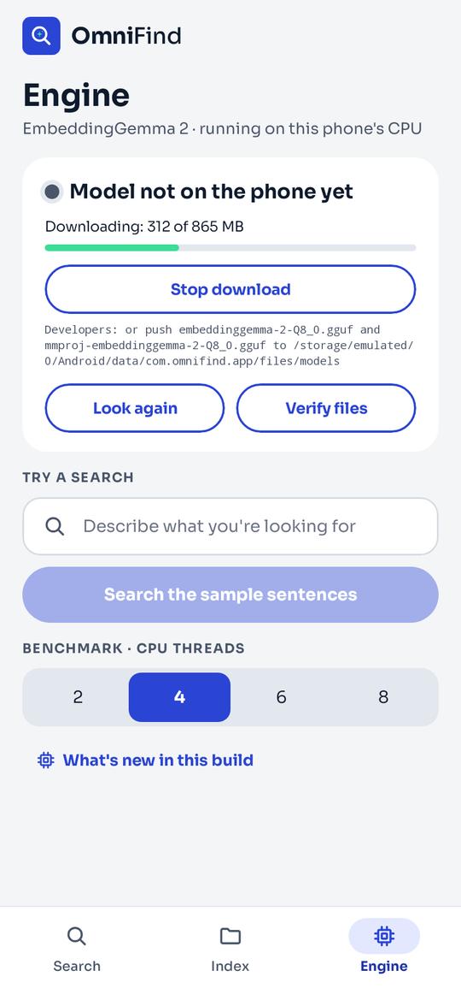
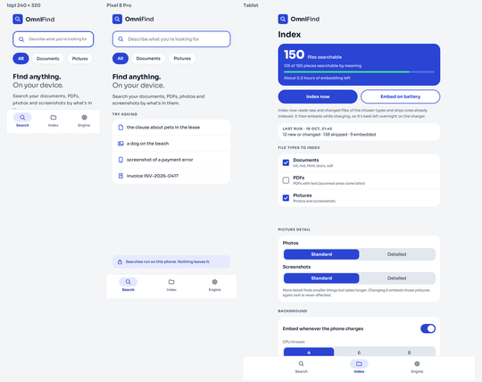
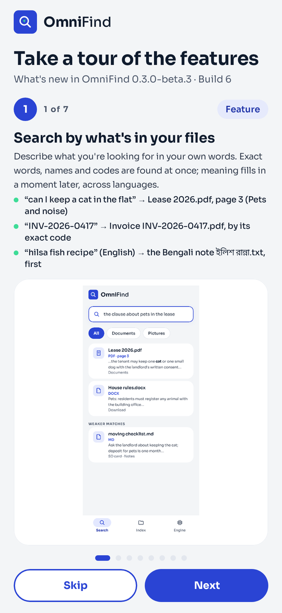

# OmniFind: Product Specification (Business Requirements)

<!-- build:begin -->**OmniFind 0.3.0-beta.3 · Build 6** · 2026-10-20 · Android 9 (API 28) to Android 17 (API 37)<!-- build:end -->

## 1. Purpose

OmniFind finds the files on an Android phone by what's in them: a person describes what they're looking for in their
own words, in any of 100+ languages, and OmniFind finds the document, PDF page, photo or screenshot, on the phone,
with nothing sent anywhere. It brings [DigUp](https://github.com/ARahim3/DigUp)'s approach (Google DeepMind's
EmbeddingGemma 2 on llama.cpp, with hybrid meaning and keyword search) to Android, down to a 2017 Xiaomi Mi A1.

## 2. Users and needs

| Who | Needs |
|---|---|
| Someone with years of downloads, notes, scans and photos | Find "the lease clause about pets" or "the screenshot of the payment error" without remembering file names |
| Someone who writes in more than one language | Ask in one language, find a note in another |
| Someone careful about privacy | Search that never uploads their files, and an app that only reads what they choose |
| Someone on an older or smaller phone | An app that fits a small screen, large text, and a slow CPU (indexing on the charger) |

## 3. Scope

**In:** documents (txt, md, html, docx, odt), PDFs with text, photos and screenshots; phone storage and portable SD
cards; Android 9 (API 28) to Android 17 (API 37); arm64 phones; English UI.

**Out (for now):** scanned PDFs (milestone 4), audio and video, text inside screenshots by exact words, cloud files,
x86 devices, other UI languages.

## 4. Functional requirements

| ID | Requirement | Acceptance (test case) |
|---|---|---|
| FR-01 | Search by meaning: a description finds the matching file even with no word in common | TC-01, TC-03 |
| FR-02 | Search across languages: a question in Arabic or Bengali finds an English note | TC-02, TC-03 |
| FR-03 | Exact words, names and codes are found as soon as a file is read, before any meaning is computed | TC-03 |
| FR-04 | Photos and screenshots are searchable by what they show, ranked together with text | TC-04 |
| FR-05 | People choose the file types to index (documents, PDFs, pictures); unticked types stay searchable | TC-05 |
| FR-06 | A file already indexed and unchanged is never read or embedded again; a caution says so before indexing | TC-05 |
| FR-07 | People choose folders on phone storage and on an SD card, including "everything" on either | TC-06 |
| FR-08 | **Refresh**: under Phone storage and under SD card, a Refresh button lists folders made since (by the person, a camera or another app), marking them New and saying what it found | TC-06, TC-07 |
| FR-09 | **System folders are protected**: Android/ (other apps' data, obb, media), LOST.DIR, trash and hidden folders are never listed, chosen or read; links and `..` paths can't lead into them | TC-06 |
| FR-10 | The model (865 MB) downloads in the app, over Wi-Fi, resumable, checked before use | TC-10 |
| FR-11 | Indexing runs in the background, embeds only while charging (unless asked), stops when hot, and loses nothing when stopped | TC-03, TC-04 |
| FR-12 | **Take a tour of the features**: after a fresh install or an update to a new build, a numbered walk-through of the release's features and fixes, with screenshots from build validation, shown once per build and reopenable from Engine → What's new | TC-09 |
| FR-13 | Every release's tour, release notes and this walk-through come from one manifest and carry the build number | TC-09 |

## 5. Non-functional requirements

| ID | Requirement | Acceptance |
|---|---|---|
| NFR-01 | **Privacy:** files never leave the phone; the only network use is the model download; no analytics | Code review; manifest permissions |
| NFR-02 | **Least access:** read only, only chosen folders, never other apps' storage (Android storage security guidance) | TC-06 |
| NFR-03 | **Android 9 to 17:** minSdk 28, targetSdk 37; edge to edge (enforced from Android 15); All files access on 11+; notifications permission on 13+; 16 KB pages on 15+ | TC-10, lint (0 errors) |
| NFR-04 | **Every density:** ldpi to xxxhdpi, phones, tablets, landscape, 130% and 200% text: nothing clipped, overlapped or cut off | TC-08 |
| NFR-05 | **Design:** screens match the approved mockups (Sora, #2A44D4 / #3DDC97), within about 1 dp | TC-07 |
| NFR-06 | **Speed on a Mi A1:** a search answers in about 0.5 s; indexing sized by measured costs (about 25 s per text piece, 18 s per photo) | TC-01 timings |

## 6. Walk-through of this release

<!-- walkthrough:begin -->
### Feature walk-through: OmniFind 0.3.0-beta.3, build 6

Shown in the app as **Take a tour of the features** after installing or updating to build 6 (and from Engine → What's new). Screenshots and highlights come from build validation: a run on a device with sample data where noted, otherwise `TourScreenshotTest` and `DeviceMatrixTest`.

| Validation run | |
|---|---|
| Device | Pixel 8 Pro emulator (1344 × 2992, 480 dpi), Android 17 (API 37), arm64 |
| Data | 19 sample files from tools/demo/make_sample_data.py: 7 documents, 4 PDFs, 5 photos, 3 screenshots |
| Model | Copied from the Mac with adb (not downloaded in the app) |

**1. Search by what's in your files** · _Feature_

Describe what you're looking for in your own words. Exact words, names and codes are found at once; meaning fills in a moment later, across languages.

Highlights from the validation run:

- “can I keep a cat in the flat” → Lease 2026.pdf, page 3 (Pets and noise)
- “INV-2026-0417” → Invoice INV-2026-0417.pdf, by its exact code
- “hilsa fish recipe” (English) → the Bengali note ইলিশ রান্না.txt, first

Verified by: TC-01 (Engine matches DigUp's reference vectors), TC-02 (A question in one language finds a note in another), TC-03 (Words first, then meaning, on 30 notes)

_Screenshot: Pixel 8 Pro emulator, Android 17, build 5, sample data._

**2. Photos and screenshots by what they show** · _Feature_

Pictures are searched by what's in them, not their names. The Pictures filter shows matches as a grid.

Highlights from the validation run:

- “mountains by a lake” → mountain_lake.jpg (Pictures filter)
- “dog running on the beach at sunset” → beach_sunset.jpg
- “screenshot of a payment error” → the Payment declined screenshot

Verified by: TC-04 (Photos and screenshots found among notes)

_Screenshot: Pixel 8 Pro emulator, Android 17, build 5, sample data._

**3. Choose what to index** · _Feature_

Tick documents, PDFs and pictures. Files already indexed and unchanged are skipped, and nothing is embedded twice.

Highlights from the validation run:

- 19 files read; all 21 pieces (13 text, 8 pictures) searchable by meaning
- The next run: 0 new or changed · 19 skipped · 21 embedded, nothing read twice
- Before it, a caution: “7 documents, 4 PDFs, 8 pictures” are already in the index

Verified by: TC-04 (Photos and screenshots found among notes), TC-05 (Indexed files are skipped; unticked types stay)

_Screenshot: Pixel 8 Pro emulator, Android 17, build 5, sample data._

**4. Refresh folders, system folders protected** · _New in this build_

Tap Refresh under Phone storage or SD card to list folders made since; new ones are marked New. Android's system folders and other apps' files are never shown or read.

Highlights from the validation run:

- A folder made after opening the app: Refresh says “1 new folder: Scans”, marked New
- LOST.DIR, a hidden folder and Android/ exist on the device and are never listed
- A folder removed meanwhile drops out of the list

Verified by: TC-06 (Folder policy: system, hidden and linked folders refused)

_Screenshot: Pixel 8 Pro emulator, Android 17, build 5, sample data._

**5. Download the model in the app** · _Feature_

Search by meaning needs a one-time 865 MB download over Wi-Fi. It resumes if interrupted and is checked before use; nothing about your files is sent.

Highlights from the validation run:

- Waits for Wi-Fi, shows progress, and stops on request
- Each file's SHA-256 is checked before it's used

Verified by: TC-10 (Release APK: signature, Android 9–17, 16 KB pages, icons)

_Screenshot: Rendered by TourScreenshotTest (the download wasn't run on the emulator)._

**6. Fits every screen** · _Fixed in beta.2_

Phones from small ldpi screens to the Pixel 8 Pro, tablets and landscape, with large text: nothing overlaps or is cut off, and the app runs edge to edge on Android 15 to 17.

Highlights from the validation run:

- Checked from ldpi to xxxhdpi, on a tablet, in landscape and at 200% text
- Edge to edge on the Pixel 8 Pro emulator, Android 17

Verified by: TC-07 (Screens match the design mockups), TC-08 (Screens on ldpi to xxxhdpi, tablet, landscape, 130% and 200% text)

_Screenshot: Rendered by DeviceMatrixTest._

**7. This tour, after every update** · _New in this build_

The tour opens once after you install or update OmniFind. Open it again any time from Engine → What's new.

Highlights from the validation run:

- Shown after an update (build 5 → 6 on the emulator); not again on relaunch
- Seven numbered steps, then the fixes and known issues

Verified by: TC-09 (Tour shows after install or update, once per build)

_Screenshot: Rendered by TourScreenshotTest._
<!-- walkthrough:end -->

## 7. Open questions

- Scanned PDFs: page images at what detail, given about 40 s per page on a Mi A1?
- Faster engine on newer phones (dotprod/i8mm on the Pixel 8 Pro's CPU) without dropping the Mi A1.
